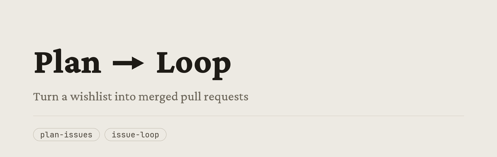

## What you're installing

| File | What it does |
| --- | --- |
| [`plan-issues`](plan-issues/) | Turns what you said you wanted into tickets a robot can actually pick up and do. It reads your code first so it isn't making things up. |
| [`issue-loop`](issue-loop/) | Works through those tickets on its own. Two at a time: write the code, have something else try to break it, open the pull request, merge it, watch it go out, grab the next two. |

Use one agent to plan, and have up to ~2 agents executing the issues.

## Dependencies

| Dependency | What it does |
| --- | --- |
| [`fable-codex-coordinator`](https://github.com/daytonbaird/fable-codex-coordinator) | The three Codex skills every ticket gets handed to — one writes the code, one tries to tear it apart, one opens the app and looks at it. Install these first. |

Without them there's nothing to hand the work to, and `/issue-loop` ends up writing the code itself, which is the one thing it's built not to do.

## Tips for success

- **It merges to main on its own.** Use a repo you own, turn on branch protections, watch the first few.
- **Your tests are the only thing catching a bad change.** Nobody reads it before it lands. Thin tests just break things faster.
- **Document your patterns so agents follow them.** They show up knowing nothing, every time. Skip this and the output is bad — [OpenAI explains it best](https://openai.com/index/harness-engineering/).
- **Put small related things in one ticket.** Every ticket costs the same setup whether it's one line or three hundred.

---

# Installation Instructions

This installs these two skills only. Install the dependency separately, from its own repo, first.

### Option 1) Ask your agent to install

Paste this to your agent and it'll do it for you:

```text
Clone this repo to /tmp/ and verbatim cp -R all skills to the folder where Claude skills
are managed globally on this machine.

    git clone https://github.com/daytonbaird/fable-issue-loop /tmp/fable-issue-loop

1. Every folder in there containing a SKILL.md is one skill.
2. Work out where Claude skills live globally on this machine, usually ~/.claude/skills/,
   and cp -R each skill folder there. Ask me if you can't tell.
3. Copy them exactly as they are. Do not rewrite, reword, shorten, or improve any
   SKILL.md. These are prompts, and the specific wording is what makes them work.
4. When you're done, write me one paragraph covering what these skills do and how you'll
   know when to use them. No jargon, speak coherently, keep it simple and short, like one
   human talking to another.
```

### Option 2) Run the commands yourself

```sh
git clone https://github.com/daytonbaird/fable-issue-loop
cd fable-issue-loop

# Copies both skill folders into ~/.claude/skills/. Use your dotfiles path
# if you symlink them in. Claude Code picks them up next session.
cp -R plan-issues issue-loop ~/.claude/skills/
```

Then, in a new session:

```text
/plan-issues <your repo>     # fill the board
/issue-loop <your repo>      # start emptying it
```

> **Read them, don't just install them.** These are text files, and they're full of my opinions — how it sorts the list, two at a time, what the labels are called. Some of that won't suit you. Change it. The commands are here if you'd rather start from something that works and edit from there.

<details>
<summary><b>How it actually works, step by step</b></summary>

<br>

### Step 1: Fill the list

**[`plan-issues`](plan-issues/)** writes the tickets. You say what you want, it goes and reads the code, then files them.

Every ticket has to pass three things:

- a person gets the gist in under a minute
- a robot showing up cold knows what to do
- it isn't so specific that the next change makes it a lie

That last one is what most tickets get wrong. Don't write down line numbers or how big a file is today — that's wrong by tomorrow. Say where things live and what's broken, and let whoever picks it up go find the rest.

The labels decide what gets worked on and in what order. A ticket with no label at all means "don't touch this" — which matters a lot once something is working the list while you're asleep.

### Step 2: Empty it

**[`issue-loop`](issue-loop/)** does the work. It sorts the list, takes the top two, and for each one: write it, break it, ship it, watch it land.

The order is version, then bugs, then whatever's marked important, then oldest first. That's the whole rule. The point is you can always tell what it's doing without asking.

Two at a time is on purpose. Any more and they start tripping over each other, and you lose the time you saved to cleanup.

### Step 3: Let them bump into each other safely

If more than one is working the same list, they have to call dibs. It puts a label on a ticket before it starts and takes it off the moment it's done, whatever "done" turned out to be. A ticket with someone else's name on it doesn't get touched.

Calling dibs on the ticket isn't enough by itself. Two unrelated tickets can still end up editing the same file, so anything sitting near someone else's work gets skipped and picked up later.

And since it grabs tickets within minutes of you writing them, **don't go back and add to one.** Whatever you add shows up after it already read the thing, so it just vanishes. Want more? Write another ticket.

### Step 4: Know when to stop and ask

Two things it won't push through on its own:

- If the ticket is a question rather than a job, it doesn't write any code. It answers on the ticket and flags it for you.
- If it's genuinely stuck — needs a login, needs someone's approval, can't get in — it says so on the ticket and flags it. If it already wrote something, it leaves that in a draft pull request so you're looking at real code instead of a description of code.

Those are the only two times it says anything on GitHub. Everything else it tells you.

</details>

Manual for now. I'll add an installer if it ever becomes annoying enough.
